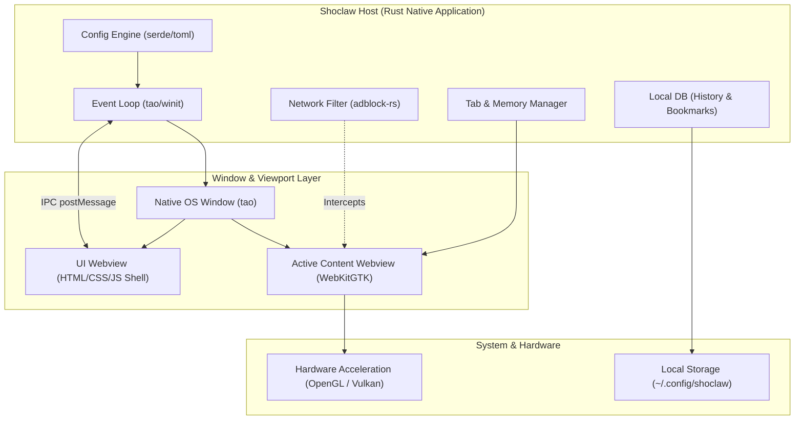
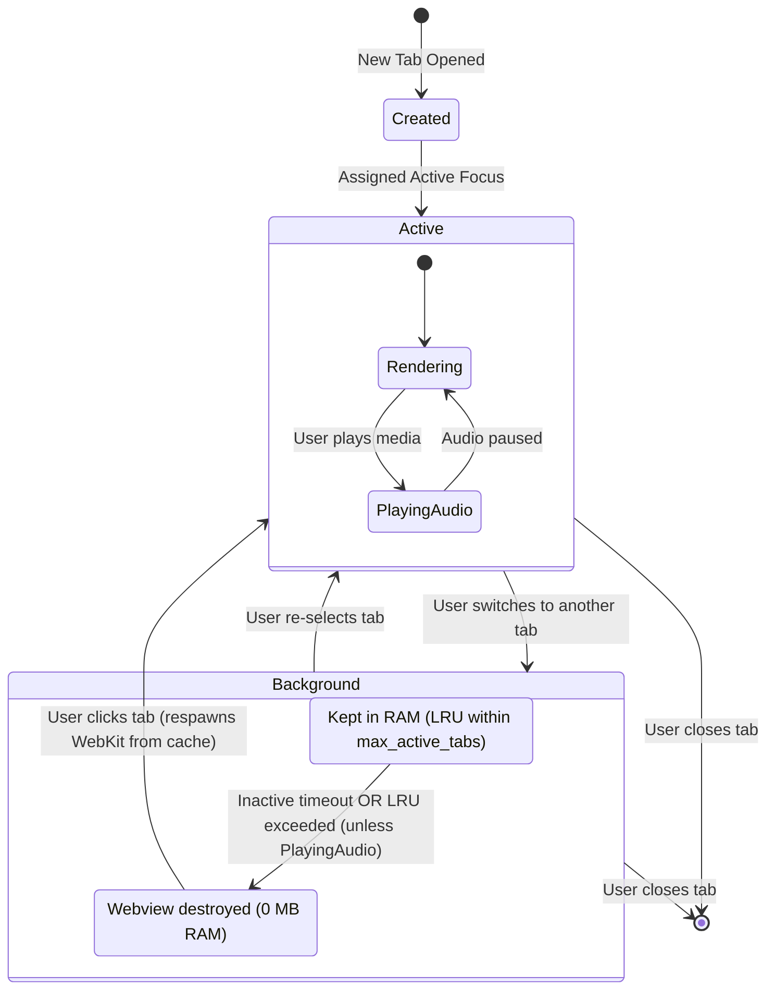
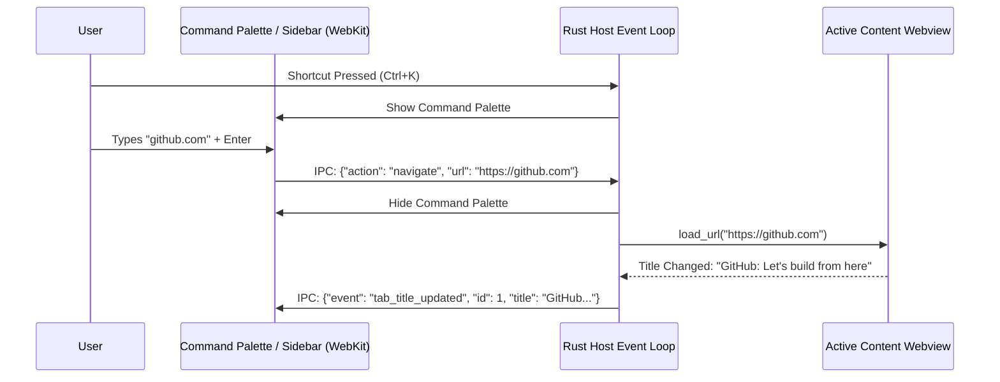

# System Architecture Document

## Project: Shoclaw Browser
**Version:** 0.1.0-draft  
**Architecture Style:** Event-driven, Multi-Webview Hybrid Native Client  
**Primary Language:** Rust 2021 Edition

---

## 1. System Overview

Shoclaw is designed as a modular, lightweight, high-performance desktop web browser. It eschews heavy JavaScript runtimes (such as Node.js in Electron) in favor of a native compiled binary that manages OS-level webview instances.



---

## 2. Technology Stack & Rationale

| Component | Technology | Rationale |
| :--- | :--- | :--- |
| **Language** | **Rust 2021** | Zero-cost abstractions, memory safety without garbage collection, unmatched performance, native binary output. |
| **Windowing & Event Loop** | **`tao`** (Tauri's cross-platform window library) | Fork of `winit` maintained specifically for webview integrations; robust Wayland & X11 support on Linux. |
| **Web Rendering Engine** | **`wry`** (wrapping WebKitGTK 4.1/6.0 on Linux) | Calls system-installed WebKit directly; zero bundled engine bloat; hardware-accelerated video/graphics; no Electron runtime. |
| **Serialization & Config** | **`serde` + `toml`** | Standard, ergonomic, and reliable config deserialization with sane defaults. |
| **Content Shield** | **`adblock` crate** | High-performance Rust implementation of the Brave adblock engine, parsing EasyList and filter rules natively. |
| **Local Storage** | **`rusqlite` / `serde_json`** | Fast, local-only storage for search history, bookmarks, and session restore. |

---

## 3. Component Decomposition & Directory Structure

```
shoclaw/
├── Cargo.toml            # Rust workspace & dependencies
├── flake.nix             # NixOS reproducible development environment
├── flake.lock
├── session.md            # Living development session changelog
├── docs/                 # Architectural & Product Documentation
│   ├── PRD.md
│   ├── ARCHITECTURE.md
│   └── TASKLIST.md
├── src/
│   ├── main.rs           # Entry point, CLI flags, initialization
│   ├── app.rs            # Application state & runtime coordinator
│   ├── config.rs         # TOML Configuration reader & watcher
│   ├── tab/
│   │   ├── mod.rs        # Tab module exports
│   │   ├── manager.rs    # TabManager: creation, switching, LRU hibernation
│   │   └── tab_item.rs   # Tab struct & lifecycle states
│   ├── ui/
│   │   ├── mod.rs        # UI layout coordinator
│   │   ├── bounds.rs     # Dynamic viewport bounds calculation
│   │   └── assets.rs     # Embedded HTML/CSS for command palette & sidebar
│   ├── filter/
│   │   └── blocker.rs    # AdBlock network request interceptor
│   └── storage/
│       ├── mod.rs
│       └── history.rs    # Local SQLite / file-based storage
```

---

## 4. Tab Hibernation State Machine

The core architectural differentiator of Shoclaw is the **Aggressive Tab Hibernation Engine**. Rather than allowing 30+ tabs to consume system RAM simultaneously, tabs transition dynamically through strict states:



### State Definitions:
1. **`Active`**: The currently focused tab. The `wry::WebView` is mounted, rendered, and processing user input.
2. **`Idle` (Warm Cache)**: A background tab whose `WebView` is temporarily kept alive because it is within the `max_active_tabs` threshold (default: 3).
3. **`Sleeping` (Cold State)**: The `WebView` instance is explicitly dropped (`None`). Only the metadata struct exists:
   ```rust
   pub struct Tab {
       pub id: u64,
       pub title: String,
       pub url: String,
       pub scroll_position: (i32, i32),
       pub is_pinned: bool,
       pub is_audio_playing: bool,
       pub last_accessed: std::time::Instant,
       pub webview: Option<wry::WebView>, // None when Sleeping!
   }
   ```
   *Memory footprint in Sleeping state: **< 5 KB** per tab.*
4. **`Protected`**: Any background tab with `is_audio_playing == true` is strictly barred from hibernation until audio terminates.

---

## 5. UI Layout & Viewport Geometry

Shoclaw employs a dual-webview architecture inside a single native `tao::window::Window`:

```
┌──────────────────────────────────────────────────────────────┐
│ Tao Native Window                                            │
│ ┌────────────────┐ ┌───────────────────────────────────────┐ │
│ │ Sidebar View   │ │ Content View                          │ │
│ │ (Width: W_sb)  │ │ (Width: Window_Width - W_sb)          │ │
│ │                │ │                                       │ │
│ │ [Favicon 1]    │ │                                       │ │
│ │ [Favicon 2]    │ │                                       │ │
│ │ [Favicon 3 (Z)]│ │                                       │ │
│ │                │ │                                       │ │
│ └────────────────┘ └───────────────────────────────────────┘ │
│                                                              │
│        ┌───────────────────────────────────────────┐         │
│        │ Floating Command Palette (When Activated) │         │
│        │ [ > Search or enter URL...              ] │         │
│        └───────────────────────────────────────────┘         │
└──────────────────────────────────────────────────────────────┘
```

### Dynamic Bounds Management:
* In **`expanded`** mode: Sidebar `W_sb = 220px`. Content `X = 220px`.
* In **`compact`** mode: Sidebar `W_sb = 48px`. Content `X = 48px`.
* In **`hidden` / `autohide` (collapsed)**: Sidebar `W_sb = 0px`. Content `X = 0px` (100% width).
* In **`autohide` (revealed on hover)**: Sidebar slides over or resizes content smoothly.

---

## 6. IPC Protocol & Event Communication

Communication between the UI layer (Sidebar, Command Palette) and the Rust host occurs over a strongly-typed IPC mechanism:



---

## 7. Security & Sandbox Architecture

1. **Host Isolation:** Web pages cannot access host files or execute system commands.
2. **IPC Validation:** Only whitelisted JSON messages originating from the internal UI shell are processed by the Rust backend.
3. **Local Privacy:** No cloud pings. History, cookies, and local database entries stay exclusively on user-specified local paths.
